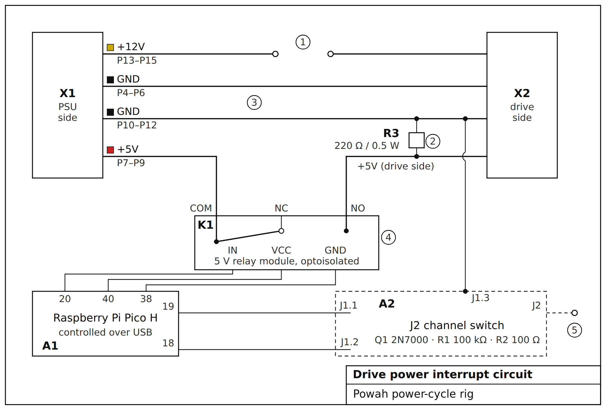

# Building the rig

The rig switches the drive's 5 V with a relay and can short a pad on the drive to ground through a small MOSFET board.
A Raspberry Pi Pico drives both and is controlled over USB.



| Ref    | Part                                                                   |
|--------|------------------------------------------------------------------------|
| X1, X2 | connectors of the modified SATA power extension (PSU side, drive side) |
| K1     | relay module                                                           |
| R3     | bleeder                                                                |
| A1     | controller (Raspberry Pi Pico H)                                       |
| A2     | J2 channel switch board ([pcb](pcb/)), parts labeled as on the board   |

The colored markers at X1 match the wire colors.
The numbered callouts:

1. 12 V wire cut, both ends left free.
2. Bleeder on the drive side, after the relay contact.
3. Both ground wires stay continuous.
   The tap is made without cutting the wire.
4. The drive on the normally open contact.
5. The J2 output, left unconnected until the drive's pad has been checked, see [Channel 2](#channel-2-rom-pad).

## Parts list

| Part                                          | Qty   | Price   | Notes                                                                 |
|-----------------------------------------------|-------|---------|-----------------------------------------------------------------------|
| Raspberry Pi Pico H                           | 1     | ~$6     | MicroPython, USB CDC                                                  |
| 1-channel 5 V relay module with optoisolation | 1     | ~$3     | power channel                                                         |
| `switch-2n7000` PCB ([pcb](pcb/))             | 1     | $13.33  | J2 channel. The price is for a batch of 10, with shipping and customs |
| PCB parts ([list](pcb/README.md#parts))       | 1 set | pennies | Q1, R1, R2, J1                                                        |
| 220 Ω / 0.5 W resistor                        | 1     | pennies | R3, bleeder, see below                                                |
| SATA power extension (male-female)            | 1     | ~$3     | four wires, no 3.3 V, gets cut                                        |

About $26 in total.

## Channel 1: power

A 2.5" SATA SSD only needs 5 V and ground.

The extension used here has four wires: red (5 V), yellow (12 V) and two black (GND).
It has no orange 3.3 V wire.

SATA power connector pinout (15 pins):

```
P1–P3   3.3 V   orange (missing in this extension)
P4–P6   GND     black
P7–P9   5 V     red
P10–P12 GND     black
P13–P15 12 V    yellow
```

Modifying the extension:

- red (5 V): cut it and take both ends to the relay's normally open contact (COM and NO, see below)
- yellow (12 V): cut it and leave it open
- black (GND): leave both uncut

If your extension does have an orange 3.3 V wire, cut it and leave it open rather than switching it along with 5 V.
Some drives keep themselves alive through the protection diodes on 3.3 V, so the controller doesn't fully reset.

### Bleeder

A 220 Ω / 0.5 W resistor between 5 V and GND on the drive side, after the relay.
SSD bulk capacitors are typically 100 to 470 µF.
Without a bleeder they only discharge through leakage, and the voltage can hang on for seconds after the cut.
With 220 Ω and 470 µF the time constant is about 0.1 s, and the 5 V line falls below 0.3 V in about 0.3 s.
The default off time of 1.5 s covers that.
The bleeder draws about 23 mA while the power is on.

### Finding the off time

Measure it once with a multimeter or a scope:

1. Cut the power and watch the 5 V line on the drive side.
2. Time how long it takes to fall below 0.3 V.
3. Set the off time (`--off-ms`) to three times that.

An off time that's too short is the most common reason a home-made rig behaves randomly.
The controller then starts from a state that wasn't fully reset and enters ROM mode only some of the time.

## Channel 2: ROM pad

Many SSD controllers enter ROM mode when a strap pad on the drive's PCB is shorted to ground while the power comes up.
The board's J2 output makes that short under control of the firmware.

- The channel only shorts the pad to ground.
  If the pad turns out to be an output of the controller, driving it high would damage it.
- R2 (100 Ω) on the board limits the current in case the pad is an output.
- The firmware releases J2 by itself after [`ROM_MAX_ON_MS`](../README.md#firmware-settings), so a hung script can't
  leave it shorted.
- The rig ground and the drive ground have to be common.
  They are, because the power comes from the same source through the extension.

Leave J2 unconnected until the pad has been checked.
Short the pad to ground by hand with a piece of wire, check that the drive comes up in ROM mode, and measure whether the
pad is pulled up.
Then solder a wire from J2 to the pad.

## Connecting to the Pico

Board `switch-2n7000` ([pcb](pcb/)), J1 counted from the square pad:

| J1        | Goes to                                              |
|-----------|------------------------------------------------------|
| J1.1 GP14 | Pico pin 19 (GP14)                                   |
| J1.2 GND  | Pico pin 18 (GND)                                    |
| J1.3 GND  | drive ground, a tap on a black wire of the extension |

| Relay module | Goes to                  |
|--------------|--------------------------|
| IN           | Pico pin 20 (GP15)       |
| VCC          | Pico pin 40 (VBUS 5 V)   |
| GND          | Pico pin 38 (GND)        |
| COM          | red 5 V wire, PSU side   |
| NO           | red 5 V wire, drive side |

J1.2 and the relay's GND go to separate Pico GND pins.
They're all the same ground, but this way the relay coil's pulsed current doesn't share a wire with the MOSFET gate's
reference.

J1.3 puts the MOSFET's source on the drive ground, so shorting J2 is a short path to the controller's ground and not a
loop through USB and the PSU.
Tap a black wire of the extension without cutting it: open a window in the insulation, solder a wire on and cover it
with heat-shrink.
The bleeder's ground goes to the same point.
J1.3 only matters once J2 is connected, so for tests with just the Pico it can stay empty.

### Which terminal is COM, NO and NC

The relay's screw terminal has three positions: NO, COM and NC.
COM is often in the middle, but not always, so find out with an ohmmeter.
Start with the module unpowered and nothing connected:

1. Check continuity of pairs 1-2, 2-3 and 1-3.
   Exactly one pair shows ≈ 0 Ω, and that's COM + NC.
   The third, lone screw is NO, which takes the wire from the drive side.
2. Connect the module's IN, VCC and GND to the Pico as in the table above and switch between `PWR ON` and `PWR OFF`.
   The shorted pair changes.
   The screw that's in both pairs is COM, which takes the wire from the PSU side.
   NC stays empty.

The `NO COM NC` print next to the screws and the contact diagram on the relay case help, but confirm them with the
measurement anyway.

NO is open while the coil is unpowered, so a dead Pico or a pulled USB cable leaves the drive without power.

The relay module used here is active-low, like most cheap ones, so the firmware has `PWR_ACTIVE_HIGH = False`.
Check it with the ohmmeter before plugging in the drive: right after the Pico starts, COM-NO has to be open, and
`PWR ON` has to close it.
If it's the other way round, flip the flag in [pico_rig.py](../firmware/pico_rig.py).
Don't go by the module's LED, because it only shows the input.
The check also catches a known problem with 5 V modules on a 3.3 V GPIO: the Pico's high level leaves about 1.7 V across
the optocoupler input, and on some modules that's enough to keep the relay from releasing.

Once the wiring is done, go through [Bring-up](../README.md#bring-up).
