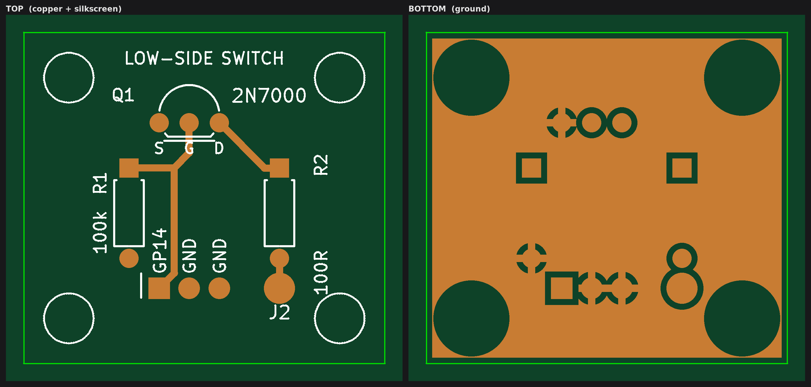

# 2N7000 low-side switch board

Two-layer board, all through-hole parts.
The bottom layer is a ground pour.
The GND pads have thermal reliefs, so they solder as easily as the rest.

## Specs

| Parameter         | Specification                                         |
|-------------------|-------------------------------------------------------|
| Size              | 30.48 × 27.94 mm                                      |
| Layers            | 2                                                     |
| Thickness         | 1.6 mm                                                |
| Narrowest trace   | 0.6 mm                                                |
| Minimum clearance | 0.5 mm                                                |
| Component holes   | 0.8 mm (Q1, R1, R2), 1.0 mm (pin header), 1.2 mm (J2) |
| Mounting holes    | 4 × 3.2 mm (M3), non-plated                           |

## Ordering

Zip the `switch-2n7000-gerber/` folder and upload it to the board house.

| File                     | Layer                  |
|--------------------------|------------------------|
| `switch-2n7000.GTL`      | Top copper             |
| `switch-2n7000.GBL`      | Bottom copper          |
| `switch-2n7000.GTS`      | Top solder mask        |
| `switch-2n7000.GBS`      | Bottom solder mask     |
| `switch-2n7000.GTO`      | Top silkscreen         |
| `switch-2n7000.GKO`      | Board outline          |
| `switch-2n7000-PTH.TXT`  | Plated drill holes     |
| `switch-2n7000-NPTH.TXT` | Non-plated drill holes |

## Parts

| Ref | Part                               | Notes                                                                    |
|-----|------------------------------------|--------------------------------------------------------------------------|
| Q1  | 2N7000, TO-92                      | A BS170 works too, but its pinout is reversed. Check before you fit one. |
| R1  | 100 kΩ, 1/4 W, axial               | 7.62 mm lead spacing                                                     |
| R2  | 100 Ω, 1/4 W, axial                | 7.62 mm lead spacing                                                     |
| J1  | 1×3 male pin header, 2.54 mm pitch | none                                                                     |

## Checks after soldering

Before hooking anything up, go through these in order.

### 1. Multimeter checks

Nothing connected, no power:

| Probes                         | Expect                                                                                                                                          |
|--------------------------------|-------------------------------------------------------------------------------------------------------------------------------------------------|
| J1.1 (GP14) to J1.2/J1.3 (GND) | about 100 kΩ (R1)                                                                                                                               |
| J2 to the transistor's D pin   | about 100 Ω (R2)                                                                                                                                |
| J1.2 to J1.3                   | short                                                                                                                                           |
| J2 to GND                      | open. If it conducts like a diode, Q1 is in backwards (S and D swapped). About 100 Ω means the S and D pins are bridged. Stop there either way. |

Mind the probe polarity on the last check.
The 2N7000 has a body diode from S to D, so put the red probe on J2 and the black one on GND.
The other way round the diode conducts (a few hundred Ω, or about 0.6 V in diode mode) and a good board looks exactly
like one with Q1 in backwards.

Then look it over: Q1's flat side faces the header (double line on the silkscreen), no solder bridges between the TO-92
pins, and J1 sits straight.

### 2. Live test with the Raspberry Pi Pico H

No real load, just a 10 kΩ pull-up:

1. Load [pico_rig.py](../../firmware/pico_rig.py) onto the Pico and run it.
2. Wire J1: GP14 to Pico pin 19, GND to Pico pin 18.
3. Connect a 10 kΩ resistor from J2 to 3.3 V.
4. Measure J2 relative to GND with a voltmeter:
    - `ROM OFF` → about 3.3 V
    - `ROM ON 5000` → close to 0 V
5. Run `ROM ON` without an argument and verify that the output releases automatically after `ROM_MAX_ON_MS` (15 s).

## Technical notes

- R2 (100 Ω) sits in series with the drain, between Q1 and the J2 output pad.
  That makes it the real current limit on this board: at 50 mA it already dissipates its full 1/4 W (I²·R), so keep the
  continuous current to roughly 30 mA or less.
  With the switch on, J2 also ends up at about I × 100 Ω above ground.
- Q1 (2N7000) itself is rated for 200 mA continuous and 60 V.
  With R2 in place the current is nowhere near that, and the 60 V is the ceiling for whatever J2 gets pulled up to.
- The 2N7000 isn't a logic-level part: Vgs(th) is specified up to 3 V, and Rds(on) is only given at 4.5 V and 10 V on
  the gate.
  From the Pico's 3.3 V a typical part switches the few tens of mA this board allows without trouble, but a worst-case
  one may not pull J2 all the way down under load.
  A logic-level part such as the AO3400 would be the better choice electrically, but it's SMD and doesn't fit the TO-92
  footprint.
- R1 (100 kΩ) keeps the gate pulled to ground while the microcontroller pin is high-impedance, e.g. during reset or
  boot, so Q1 stays off.
- J1 pinout: pin 1 (square pad) = GP14 (gate), pins 2 and 3 = GND, tied together on the board.
